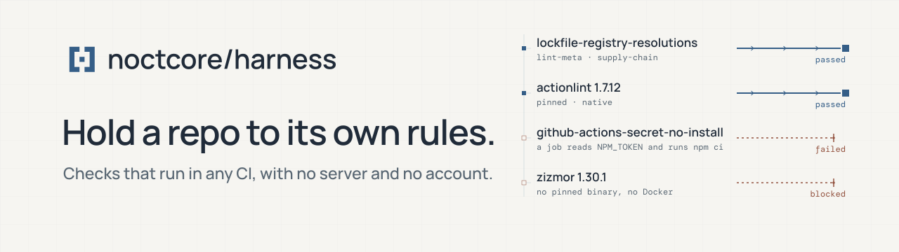

<div align="center">
  <picture>
    <source media="(prefers-color-scheme: dark)" srcset="assets/brand/readme-header-dark.svg">
    <source media="(prefers-color-scheme: light)" srcset="assets/brand/readme-header-light.svg">
    
  </picture>

  <p><strong>Verification harness modules for TypeScript monorepos: checks that hold a repo to its own rules in any CI, with no server, no account and no runtime dependencies.</strong></p>

  <p>
    <a href="https://www.npmjs.com/package/@noctcore/harness"></a>
    <a href="https://github.com/noctcore/harness/actions/workflows/ci.yml"></a>
    <a href="LICENSE"></a>
    
    
  </p>

  <p>
    <a href="https://noctcore.github.io/harness/"><strong>Docs</strong></a>
    &nbsp;·&nbsp;
    <a href="packages/harness"><strong>Package</strong></a>
    &nbsp;·&nbsp;
    <a href="CONTRIBUTING.md"><strong>Contributing</strong></a>
    &nbsp;·&nbsp;
    <a href="SECURITY.md"><strong>Security</strong></a>
  </p>
</div>

## What it is

A repo's rules usually live in three places at once: a lint config, a few scripts, and the memory
of whoever set them up. They drift, a new linter release turns CI red on nobody's change, and a
check that could not run quietly counts as a pass. `@noctcore/harness` puts the rules in files the
repo commits and runs them the same way everywhere: one `harness.json` that lists the checks, one
registry of whole-repo rules ESLint cannot reach, and linters pinned to an exact version. Every
check runs (one CI run shows the whole failure set), every command is printed before it runs, and a
check that could not run is a failure, never a pass.

## Quickstart

Install it as a devDependency (or skip the install and run it with `npx`):

```sh
npm install --save-dev @noctcore/harness   # or: pnpm add -D, bun add -d
```

List the checks in `.nightcore/harness.json`:

```json
{
  "schemaVersion": 1,
  "checks": [
    { "name": "unit-tests", "kind": "test", "command": "node --test" },
    { "name": "repo-rules", "kind": "lint-meta", "command": "npx harness lint-meta", "timeoutMs": 120000 }
  ]
}
```

Run them, locally or as a CI step:

```sh
npx harness check
```

```
→ unit-tests: node --test
→ repo-rules: npx harness lint-meta
✓ unit-tests (exit 0)
✓ repo-rules (exit 0)

Structure lock passed (2 checks).
```

It exits `0` when every check passed and `1` when any failed, printing each failed check with its
command and the tail of its output. With no `.nightcore/harness.json` it exits `0`: the lock is
opt-in by presence. A command is split on whitespace and spawned without a shell, so pipes, `&&` and
quotes do not work in it; point a check at a script instead.

## What each entry point does

| Import or command | What it does |
|---|---|
| `harness check` | Runs every enabled check in `.nightcore/harness.json` with a per-check timeout (default 5 minutes), records each outcome and exits `1` if any failed. `--json` prints the result as one JSON document. |
| `harness lint-meta` | Imports exactly one rule registry (`.nightcore/lint-meta/registry.{mts,ts,js}`) and runs its rules. A critical violation, or a rule that throws, exits `1`. |
| `harness catalog` | Writes a Markdown table of the registry's rules; `--check` fails when the committed one is stale. |
| `@noctcore/harness` | The manifest and result types, the lint-meta contract (`IMetaRule`, `IMetaCtx`, `IViolation`), the ratchet helpers (`loadBaseline`, `isGrandfathered`, `serializeBaseline`) and `portableFileGlob`. |
| `@noctcore/harness/rules` | Six ready-made lint-meta rules as factories: `lockfile-registry-resolutions`, `single-version-dependencies`, `only-built-dependencies-have-scripts`, `pnpm-patch-ledger`, `github-actions-secret-no-install` and `github-actions-security-no-cancel`. |
| `@noctcore/harness/pinned-tools` | Runs zizmor, actionlint and gitleaks at exactly their pinned version (native, else the image by digest, else blocked with exit 2), and installs the pinned linux binaries in CI after a sha256 check. |

A registry is a module that exports `META_RULES`. The ready-made rules sit next to your own:

```ts
// .nightcore/lint-meta/registry.mts
import type { IMetaRule } from '@noctcore/harness';
import {
  createGithubActionsSecretNoInstallRule,
  createGithubActionsSecurityNoCancelRule,
} from '@noctcore/harness/rules';

import { readmeHasLicense } from './rules/readme-has-license.mts';

export const META_RULES: IMetaRule[] = [
  createGithubActionsSecretNoInstallRule(),
  createGithubActionsSecurityNoCancelRule(),
  readmeHasLicense,
];
```

A pinned linter is a few lines in a script of your own:

```ts
// scripts/actionlint.mts
import { exitCodeFor, nodeRunDeps, runLinter, WORKFLOW_LINTERS } from '@noctcore/harness/pinned-tools';

const result = runLinter(WORKFLOW_LINTERS.actionlint, process.cwd(), nodeRunDeps());
console.log(`actionlint: ${result.status} (${result.reason})`);
process.exit(exitCodeFor(result.status)); // 0 passed, 1 failed, 2 blocked
```

The [package README](packages/harness/README.md) has every option, and the docs site walks through
the manifest, writing a rule, baselines and each rule's config.

## Design principles

- **No network in the package.** The runner reads only what is committed in the repo it checks: no
  telemetry, no rule fetching, no self-update. The one download in the pinned-tools subpath goes
  through a `download` function the consuming repo passes in, so its origin and timeout are
  reviewed there. A test scans the built entry points for `http`, `https`, `net`, `dns` and
  `tls` imports and for any `fetch(` call.
- **Zero runtime dependencies.** `node:*` builtins only, so there is nothing to audit or pin. A
  TypeScript registry loads through Node's own type stripping (Node 22.18 or later), not a bundled
  transpiler.
- **Dependencies injected.** The pinned-tools functions take their I/O as an argument (`IRunDeps`,
  `IGitleaksRunDeps`, `IFetchDeps`) with the real ones exported beside them, a rule reads the repo
  only through the `ctx` it is handed, and a dated rule takes a `now` clock. A repo tests its own
  wiring without spawning anything.
- **Fail closed.** A timeout, a launch failure, a rule that throws, a registry or manifest named
  with a flag that is missing, a manifest from a newer schema, a linter that could not run: each
  is a failure with a reason, never a silent pass.
- **Windows and Linux.** CI runs the suites on Ubuntu and on Windows under plain Node 22, the oldest
  supported line, because the package runs in other repos' CI and on developer machines on both.

## Developing

This is a Bun workspace (`bun@1.4.2`).

```sh
bun install
bun run build
bun run typecheck && bun run lint && bun run test
bun run test:coverage
bun run check:package
```

| Path | What it holds |
|---|---|
| [`packages/harness`](packages/harness) | `@noctcore/harness`: the runner, the lint-meta engine, `/rules` and `/pinned-tools` |
| [`assets/brand`](assets/brand) | The logo, banner and social artwork, rebuilt from `design.mjs` |

The name `@noctcore/harness-mutation` is reserved for a planned package; nothing is published under it yet.

## Contributing and releases

Read [CONTRIBUTING.md](CONTRIBUTING.md) before a pull request, and report vulnerabilities as
[SECURITY.md](SECURITY.md) describes, never in a public issue. Everyone taking part follows the
[Code of Conduct](CODE_OF_CONDUCT.md). Releases go through changesets and npm trusted publishing;
the flow is in [RELEASING.md](RELEASING.md) and every version is in the
[changelog](packages/harness/CHANGELOG.md).

## License

MIT, see [LICENSE](LICENSE).
